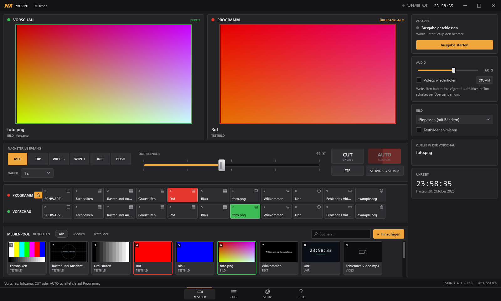
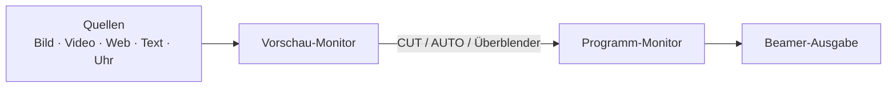

<div align="center">

# NX-Present

**Der Bildmischer für Präsentationen.**
Vorschau wählen, Programm sehen, mit AUTO überblenden.

[**Installer herunterladen**](https://github.com/nexoGroups/NX-Present/releases/latest) ·
[Bedienung](docs/BEDIENUNG.md) ·
[Änderungen](CHANGELOG.md) ·
[Fehler melden](https://github.com/nexoGroups/NX-Present/issues)



</div>

NX-Present ist ein Show-Control-Programm für Windows, aufgebaut wie ein Videomischer. Der **Programm-Monitor** zeigt in Echtzeit genau das Bild, das auf der Leinwand steht, auch bei Videos und Webseiten. Im **Vorschau-Monitor** bereitest du die nächste Quelle vor. **CUT** schaltet sie sofort auf Programm, **AUTO** blendet automatisch über, und mit dem **Überblender** mischst du von Hand.

> **Stand dieser Beschreibung:** Sie folgt dem Quellcode auf `main` (Version **0.4.0**, der Bildmischer). Der Installer dieser Version erscheint mit der nächsten Veröffentlichung. Ältere Installer, etwa 0.3.1, haben noch die frühere Oberfläche. Bis dahin lässt sich 0.4.0 [selbst bauen](#selbst-bauen).

## Wofür ist NX-Present gedacht?

Ein Beamer soll die Präsentation zeigen. Dateiauswahl, Browserwechsel, Mauszeiger und die Vorbereitung des nächsten Inhalts gehören auf den Bedienmonitor, nicht auf die Leinwand.

NX-Present trennt diese beiden Welten wie ein Hardware-Mischer:



Was du in der Vorschau-Zeile wählst, siehst du zuerst im Vorschau-Monitor. Ein Video wartet dort auf seinem ersten Bild. Auf der Leinwand ändert sich nichts, bis du **CUT** oder **AUTO** drückst. Danach tauschen Programm und Vorschau die Plätze, sodass du mit AUTO zwischen zwei Quellen hin und her blenden kannst.

Das eignet sich für private Präsentationen, Hobbyprojekte und ehrenamtliche Veranstaltungen ohne kommerziellen Zweck. Die kostenlose Nutzung ist an die [Projektlizenz](LICENSE.txt) gebunden.

## Funktionen

### Mischen

- **Echter Viewer:** Der Programm-Monitor ist kein Standbild. Er zeigt dieselben Bilder wie die Ausgabe: laufende Videos, animierte Testbilder, die Uhr und Webseiten in Echtzeit. Es gibt keine Bildschirmaufnahme dazwischen.
- **CUT und AUTO:** Sofortschnitt oder automatischer Übergang mit einstellbarer Dauer. Ein Video startet erst mit der Blende, sein Ton blendet mit.
- **Überblender:** Von Hand mischen. Drückst du AUTO bei halb gezogenem Überblender, läuft der Rest der Blende automatisch.
- **FTB und Schwarz + stumm:** Weich nach Schwarz samt Ton, oder sofort schwarz und stumm. Die Vorschau bleibt dabei unverändert.
- **Programm- und Vorschau-Zeile:** Eine Taste je Quelle, mit den Ziffern 1 bis 9 wählbar, 0 wählt Schwarz. Die Programm-Tasten sind gegen Fehlklicks gesperrt, bis du sie freigibst.

### Sechs Übergänge

| Taste | Übergang | Wirkung |
| --- | --- | --- |
| MIX | Überblenden | Das neue Bild blendet über das alte |
| DIP | Über Schwarz | Das alte Bild blendet nach Schwarz, das neue aus Schwarz |
| WIPE → | Wischen waagerecht | Eine weiche Kante zieht waagerecht über das Bild |
| WIPE ↓ | Wischen senkrecht | Eine weiche Kante zieht senkrecht über das Bild |
| IRIS | Iris | Das neue Bild öffnet sich als wachsender Kreis aus der Mitte |
| PUSH | Schieben | Das neue Bild schiebt das alte nach links aus dem Bild |

### Quellen im Medienpool

| Quelle | Hinweise |
| --- | --- |
| Bilder | JPG, PNG, BMP, GIF, TIFF. Fotos stehen aufrecht, auch im Hochformat; sehr große Bilder werden verkleinert. GIFs erscheinen als Standbild |
| Videos | MP4, MKV, MOV, AVI, WebM, M4V, WMV, MPEG, TS. Bis Full HD in Echtzeit, größere Videos werden verkleinert |
| Webseiten | HTTP und HTTPS in einem unsichtbaren Browser mit Full-HD-Auflösung. In dieser Fassung nicht bedienbar |
| Text | Texttafeln |
| Uhr | Die Uhrzeit als Bildquelle |
| Testbilder | Animierte Prüfbilder, die sich auch als Bewegungstest eignen |

Der Pool zeigt Vorschaubilder und bietet Suche und Filter. Dateien lassen sich hineinziehen.

### Geplante Abläufe

Der **Cue Mode** ist für Veranstaltungen mit fester Reihenfolge und eine Cue-Liste nach dem Vorbild von QLab. Die **Marke** steht auf dem nächsten Cue; **GO** startet ihn und setzt die Marke sofort weiter. Jeder Cue hat eine Nummer, **Pre-Wait**, **Dauer** und **Post-Wait** und kann mit **Auto-Continue** oder **Auto-Follow** den nächsten Cue selbst starten, sodass eine ganze Kette mit einem GO läuft. Neben Quellen gibt es Cues für Schwarzblende, Lautstärkeblende, Video-Steuerung, Pausen und Notizen. Cues lassen sich ausschalten, färben und mit einer Taste direkt abrufen; **Esc** stoppt alles Wartende. Pool und Cue-Liste lassen sich als `.nxshow`-Datei sichern.

### Ausgabe

- **Ausgabeschutz:** Die Ausgabe läuft im Vollbild im Vordergrund; die Maus lässt sich auf den Bedienmonitor begrenzen. Der globale Notausstieg **Strg + Alt + F10** gibt beides frei.
- **Immer mit Schwarzbild:** Eine gestartete Ausgabe beginnt schwarz. Auf einem neuen PC wählst du den Beamer ausdrücklich selbst; NX-Present vermutet keine Anzeige.
- **Gemeinsames Audiogerät:** Ein Gerät für Videodateien und Webseiten. Die vorherige Windows-Auswahl wird beim normalen Beenden wiederhergestellt.
- **Ohne Beamer nutzbar:** Der Mischer läuft vollständig ohne Ausgabefenster. Der Programm-Monitor zeigt, was auf der Leinwand stünde, so lässt sich ein Ablauf an einem Monitor proben.
- **Gespeichert wird automatisch:** Pool, Ablauf, Übergang, Dauer, Lautstärke, Geräte und Fenstergröße.

### Updates

NX-Present sucht beim Start im Hintergrund auf der offiziellen GitHub-Veröffentlichungsseite nach einer neueren Version und installiert sie selbst, solange nichts live ist. Läuft schon Inhalt, wartet das Update: Die Statusleiste zeigt **UPDATE x.y.z**, und du startest es unter **Setup → Updates** mit **Jetzt aktualisieren**. Dort lässt sich die Suche beim Start und die automatische Installation auch ausschalten, und **Nach Updates suchen** prüft von Hand. Einstellungen, Pool und Cue-Liste bleiben beim Update erhalten.

## Installieren

1. Öffne die [Veröffentlichungen](https://github.com/nexoGroups/NX-Present/releases/latest).
2. Lade das Setup herunter (**NX-Present-Setup-…-x64.exe**). Der von GitHub automatisch angebotene Download **Source code** ist der Quellcode, kein fertiges Programm.
3. Starte das Setup und akzeptiere die Nutzungsbedingungen, wenn du sie einhalten möchtest.
4. Öffne NX-Present über das Startmenü oder die Desktop-Verknüpfung.

Das Setup installiert für dein Windows-Benutzerkonto. Eine eigene Installation von .NET oder VLC ist nicht nötig, die Laufzeitdateien liegen bei. Für Webseiten braucht NX-Present Microsoft Edge WebView2; fehlt diese Laufzeit, installiert das Setup den offiziellen Microsoft-Bootstrapper, wofür eine Internetverbindung nötig ist.

**Aktualisieren:** Eine installierte Fassung ab 0.4.0 aktualisiert sich selbst (siehe [Updates](#updates)). Ältere Fassungen wie 0.3.1 kennen die Funktion nicht; installiere für den Wechsel einmal das neue Setup von Hand, es ersetzt die alte Version und behält deine Einstellungen. Eine selbst gebaute Kopie wird von der Update-Funktion nie überschrieben, sie meldet nur, dass es eine neue Version gibt.

**System:** Windows 11, 64 Bit, Intel/AMD. Windows 10 ab 22H2 lässt der Installer zu, es wurde aber nicht gesondert geprüft. Für die Beamer-Ausgabe brauchst du zwei getrennte Anzeigen im Windows-Modus **Erweitern**. ARM64, macOS und Linux werden nicht angeboten.

**Signatur:** Die Veröffentlichungen sind **nicht mit einem eigenen Code-Signing-Zertifikat signiert**. Windows kann deshalb einen unbekannten Herausgeber anzeigen. Auf PCs mit aktivierter **Smart App Control** oder strengen Richtlinien kann der Start unsignierter Programme blockiert werden, auch bei selbst gebauten. NX-Present fordert dich nicht auf, Windows-Schutzfunktionen abzuschalten. Die SHA-256-Prüfsumme im Release hilft, die heruntergeladene Datei mit der veröffentlichten zu vergleichen; sie ersetzt keine Signatur. Die Update-Funktion prüft jedes geladene Setup genauso gegen die `SHA256SUMS.txt` derselben Veröffentlichung und lädt nur von `github.com/nexoGroups/NX-Present/releases`. Das erkennt beschädigte oder unvollständige Downloads, aber keine manipulierte Veröffentlichung. Blockiert Windows ein Update-Setup, meldet NX-Present das und lässt die Datei im Ordner `%LOCALAPPDATA%\NX-Present\Updates` liegen.

## In einer Minute startklar

1. Verbinde Beamer und Bedienmonitor und wähle in Windows **Erweitern**.
2. Wähle beim ersten Start unter **Setup** den Ausgabe-Bildschirm.
3. Wähle bei Bedarf das Audiogerät und klicke **Ton anwenden**.
4. Starte die Ausgabe. Sie beginnt mit einem vollständigen Schwarzbild.
5. Wähle eine Quelle in der **Vorschau-Zeile** oder im **Medienpool**. Sie erscheint im Vorschau-Monitor.
6. Drücke **AUTO** zum Überblenden oder **CUT** zum Schneiden.

Zum Ausprobieren ohne eigene Medien liegt `examples/Demo.nxshow` bei, mit Testbildern, Uhr und Text.

| Taste | Wirkung |
| --- | --- |
| **Leertaste**, **Strg + Enter** | AUTO (auf der Cue-Seite: GO) |
| **Eingabetaste** | CUT |
| **1 bis 9**, **0** | Quelle bzw. Schwarz in die Vorschau |
| **F** | Fade to Black ein / aus |
| **Strg + B** | Sofort schwarz und stumm |
| **Esc** | Cue-Seite: alle wartenden und laufenden Cues stoppen |
| **↑ ↓** | Cue-Seite: Marke bewegen |
| **M** | Ton stumm |
| **Strg + Alt + F10** | Global: Ausgabe schließen und Maus freigeben |

Die ausführliche Anleitung steht in der [Bedienung](docs/BEDIENUNG.md); eine Kurzfassung liegt als `Hilfe.html` der Installation bei und hat einen Eintrag im Startmenü.

## Was du vor dem Einsatz wissen solltest

**Ton:** Die gemeinsame Gerätewahl ändert das Windows-Standardausgabegerät und betrifft dadurch auch andere Programme. Die Lautstärke in NX-Present regelt Videos, ihr Ton blendet bei Übergängen mit. Webseiten haben ihre eigene Lautstärke; ihr Ton schaltet bei einer Blende um, ohne zu überblenden. **Stumm** wirkt auf beide.

**Videos:** Sie laufen über die Software-Dekodierung der Video-Engine. Sehr hohe Auflösungen und Bitraten belasten die CPU stark, auch wenn das Bild auf Full HD verkleinert wird.

**Webseiten:** Sie erscheinen als Bild und lassen sich in dieser Fassung nicht anklicken oder bedienen. Downloads, Kamera und Mikrofon sind deaktiviert.

**Bildrate:** Die Ausgabe zielt auf die Bildwiederholrate des Beamers. Durchgehend konstante 60 FPS sind nicht bestätigt; Auflösung, Grafiktreiber und Auslastung beeinflussen das Ergebnis. Videos behalten ihre ursprüngliche Bildrate.

**Ausgabeschutz:** NX-Present kann die Maus begrenzen und das Ausgabefenster vorn halten. Windows-Systemdialoge und privilegierte Fenster können trotzdem darüber liegen. Der Schutz ist keine Windows-Kiosksperre.

**Dateien:** Showdateien verknüpfen Medien, statt sie einzubetten. Nimm beim Umziehen auch die Mediendateien mit. Die Testbilder sind praktische Prüfbilder, keine normierten Kalibriersignale.

**Nicht an Hardware geprüft:** Die automatischen Prüfungen decken Logik, Übergänge, Oberfläche, echtes Video und echte Webseiten ab. Das Verhalten mit einem tatsächlichen Beamer, die Tonausgabe bei einem Gerätewechsel während der Wiedergabe und die Bildrate unter hoher Last sind nicht an Hardware geprüft. Probiere Bild, Ton und Notausstieg vor einer Veranstaltung mit deiner eigenen Ausrüstung aus.

## Selbst bauen

Für den Programm-Build genügt das **.NET 10 SDK unter Windows**; Visual Studio ist nicht erforderlich. Zum Bauen des Installers kommt **Inno Setup 7** hinzu.

```powershell
# Im geklonten Repository:
.\scripts\Build.ps1

# Mit den Prüfungen, die die echte Video-Engine und WebView2 brauchen:
.\scripts\Build.ps1 -Media

# Zusätzlich eine Installations-EXE erzeugen:
.\scripts\Build.ps1 -Installer -InstallerCompiler 'C:\Program Files\Inno Setup 7\ISCC.exe'
```

Das Skript stellt die Pakete wieder her, baut die Anwendung, führt die Validierung aus und veröffentlicht eine eigenständig lauffähige Windows-x64-Fassung unter `artifacts/`. Wie das Projekt aufgebaut ist und was die Prüfungen abdecken, steht in [docs/ENTWICKLUNG.md](docs/ENTWICKLUNG.md).

Ein eigener Build ändert die Nutzungsbedingungen nicht: Nichtkommerzielle lokale Nutzung und Anpassungen sind erlaubt, die Veröffentlichung eigener Programmdateien braucht die Zustimmung des Rechteinhabers.

## Technik

C#, WPF und .NET 10. Videos spielt [LibVLCSharp](https://github.com/videolan/libvlcsharp) über die Speicherausgabe von LibVLC, Webseiten zeigt Microsoft Edge WebView2 in einem unsichtbaren Fenster, dessen Bilder per Screencast kommen. Jede Quelle liefert Bilder an dieselben Monitore wie die Ausgabe; ein gemeinsamer Compositor rechnet die Übergänge. Mehr dazu in [docs/ENTWICKLUNG.md](docs/ENTWICKLUNG.md).

## Lizenz und offizieller Download

Der Quellcode ist öffentlich einsehbar. NX-Present ist **kein unter einer freien Open-Source-Lizenz veröffentlichtes Projekt**.

- Der offizielle Download und die nichtkommerzielle Nutzung sind kostenlos.
- Kommerzielle Nutzung, Verkauf, eigene Download-Mirrors und die Weitergabe der Programmdateien sind ohne gesonderte Zustimmung nicht erlaubt.
- Verlinke auf die offizielle [Releases-Seite](https://github.com/nexoGroups/NX-Present/releases/latest), statt Dateien neu hochzuladen.
- Plattforminterne GitHub-Forks sind im Rahmen der GitHub-Bedingungen ausdrücklich ausgenommen. Ein Fork ist keine Erlaubnis, eigene Programm-Downloads anzubieten oder NX-Present kommerziell zu nutzen.
- Die Bibliotheken anderer Projekte behalten ihre eigenen Lizenzen. Deren Rechte werden durch die Projektlizenz nicht eingeschränkt.

Maßgeblich ist [LICENSE.txt](LICENSE.txt). Fremdkomponenten und ihre Quellen sind in [THIRD-PARTY.md](THIRD-PARTY.md) aufgeführt.

## Rückmeldungen

Melde Fehler unter [Issues](https://github.com/nexoGroups/NX-Present/issues). Hilfreich sind Windows-Version, NX-Present-Version, Inhaltstyp und eine kurze Beschreibung der Schritte bis zum Fehler. Zugangsdaten, private Showdateien und Browserprofile gehören nicht in öffentliche Berichte. Mehr dazu in [CONTRIBUTING.md](CONTRIBUTING.md).
