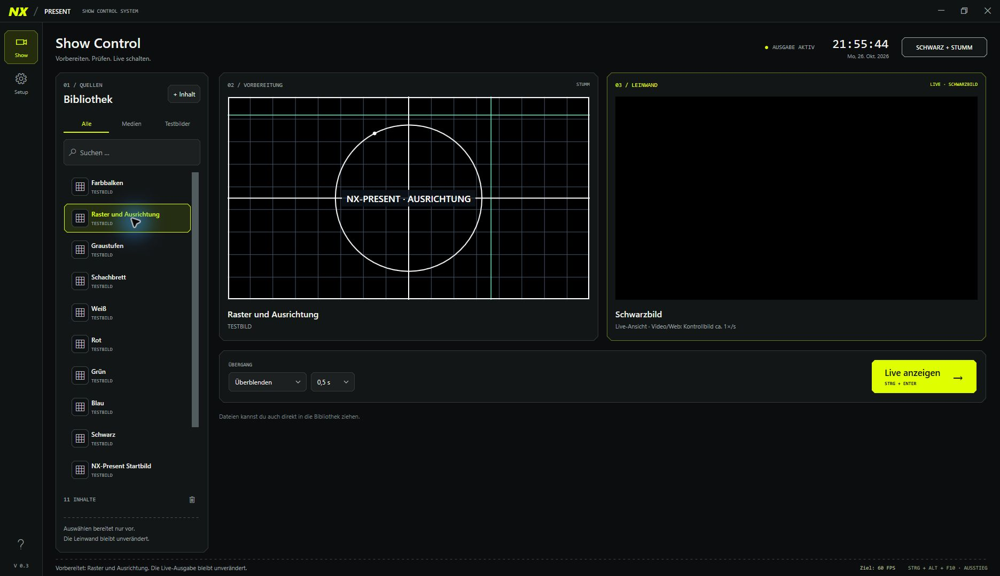

# NX-Present

**Vorbereiten am Monitor. Gezielt live auf dem Beamer.**

NX-Present ist ein Show-Control-Programm für Windows mit einer getrennten Bedienoberfläche und einer eigenen Vollbild-Ausgabe. Du bereitest Bilder, Videos, Webseiten, Texte oder Testbilder auf deinem Hauptmonitor vor und entscheidest mit **Live anzeigen**, wann sie auf der Leinwand erscheinen.

[**Windows-Installer herunterladen**](https://github.com/grummelmann/NX-Present/releases/latest) · [Bedienungsanleitung](docs/BEDIENUNG.md) · [Fehler melden](https://github.com/grummelmann/NX-Present/issues)



## Welches Problem löst NX-Present?

Ein Beamer soll die Präsentation zeigen. Dateiauswahl, Browserwechsel, Mauszeiger und die Vorbereitung des nächsten Inhalts gehören auf den Bedienmonitor.

NX-Present trennt diese Aufgaben: Links wählst du deine Quelle, in der Vorbereitung prüfst du sie stumm, rechts kontrollierst du die Ausgabe. Ein Klick schaltet den vorbereiteten Inhalt live. Mit **Schwarz + stumm** kannst du Bild und Ton sofort ausblenden, ohne den nächsten Inhalt unter Zeitdruck zusammensuchen zu müssen.

Das eignet sich zum Beispiel für private Präsentationen, Hobbyprojekte und ehrenamtliche Veranstaltungen ohne kommerziellen Zweck. Die kostenlose Nutzung ist an die [Projektlizenz](LICENSE.txt) gebunden.

## Das kann NX-Present

- **Getrennte Vorbereitung und Live-Ausgabe:** Eine neue Auswahl verändert die Leinwand erst nach deiner Freigabe.
- **Bilder, Videos und echte Webseiten:** Lokale Dateien und HTTP-/HTTPS-Adressen in einer Bibliothek mit Suche und Filtern.
- **Texte und Uhr:** Eigene Texttafeln und eine Uhr mit Sekunden und Datum als Beamer-Inhalt.
- **Animierte Testbilder:** Farbbalken, Ausrichtungsraster, Graustufen, Schachbrett und Farbflächen; die Bewegung lässt sich anhalten.
- **Übergänge:** Sofort, Überblenden oder Über Schwarz, mit wählbarer Dauer.
- **Ausgabeschutz:** Vollbild-Ausgabe im Vordergrund und Begrenzung der Maus auf den Bedienmonitor, mit globalem Ausstieg.
- **Gemeinsame Tonauswahl:** Ein Audiogerät für Videodateien und Webseiten, mit Wiederherstellung der vorherigen Windows-Auswahl beim Beenden.
- **Gespeicherte Einstellungen:** Geräte, Wiedergabeoptionen, Bibliothek, Entwürfe und vorbereiteter Inhalt werden automatisch gespeichert.
- **Showdateien:** Bibliotheken als `.nxshow` speichern und wieder laden.
- **Aufgeräumte Bedienung:** Industrieschwarz, Neongelb, abgeschrägte Rahmen und eine eigene Setup-Seite statt einer Wand aus Schaltern.

## Installieren

1. Öffne die [aktuelle Veröffentlichung](https://github.com/grummelmann/NX-Present/releases/latest).
2. Lade **NX-Present-Setup-0.3.1-x64.exe** herunter. Der automatisch von GitHub angebotene Download **Source code** ist der Quellcode, kein fertiges Programm.
3. Starte das Setup und akzeptiere die Nutzungsbedingungen, wenn du sie einhalten möchtest.
4. Öffne NX-Present über das Startmenü oder die Desktop-Verknüpfung.

Das Setup installiert für dein Windows-Benutzerkonto. Eine separate Installation von .NET oder VLC ist nicht erforderlich. Die notwendigen Laufzeitdateien liegen bei. Für Webseiten wird Microsoft Edge WebView2 benötigt; fehlt diese Laufzeit, installiert das Setup den offiziellen Microsoft-Bootstrapper. Dafür wird eine Internetverbindung benötigt.

**System:** Windows 11 auf einem Intel-/AMD-PC mit 64-Bit-Windows. Windows 10 ab 22H2 wird vom Installer zugelassen, wurde für diesen Release aber nicht gesondert geprüft. Für die Beamer-Ausgabe werden zwei getrennte Anzeigen im Windows-Modus **Erweitern** benötigt. Ein Beamer mit 60 Hz ist sinnvoll. ARM64, macOS und Linux werden nicht als eigene Version angeboten.

Die erste Veröffentlichung ist **nicht mit einem eigenen Code-Signing-Zertifikat signiert**. Entsprechend kann Windows einen unbekannten Herausgeber anzeigen oder den Start durch seine Richtlinien verhindern. Die SHA-256-Prüfsumme im Release hilft, die heruntergeladene Datei mit der veröffentlichten Datei zu vergleichen; sie ersetzt keine Signatur. Windows-Sicherheitsfunktionen müssen für NX-Present nicht abgeschaltet werden.

## In einer Minute startklar

1. Verbinde Beamer und Bedienmonitor und wähle in Windows **Erweitern**.
2. Wähle beim ersten Start unter **Setup** ausdrücklich den Ausgabe-Bildschirm. NX-Present übernimmt auf einem neuen PC keine Anzeige auf Verdacht.
3. Wähle bei Bedarf das Audiogerät und klicke **Ton anwenden**.
4. Starte die Ausgabe. Sie beginnt mit einem vollständigen Schwarzbild.
5. Wähle einen Inhalt aus der Bibliothek oder ergänze ihn über **+ Inhalt**.
6. Prüfe die Vorbereitung und klicke **Live anzeigen**.

Bei späteren Starts kann die gespeicherte Beamer-Ausgabe automatisch mit Schwarzbild eingeschaltet werden. Der zuletzt vorbereitete Inhalt geht dabei nicht automatisch live.

| Taste / Aktion | Wirkung |
| --- | --- |
| **Strg + Enter** | Vorbereiteten Inhalt live schalten, wenn das Steuerfenster aktiv ist |
| **Strg + Alt + F10** | Global: Beamer-Ausgabe schließen und Maus freigeben |
| **Schwarz + stumm** | Bild sofort verdecken und Ton stummschalten |
| **Programm beenden** oder **X** | Gesamte Anwendung beenden, Ausgabeschutz lösen und vorherige Tonauswahl wiederherstellen |

## Was du vor dem Einsatz wissen solltest

**Ton:** Die gemeinsame Gerätewahl ändert das Windows-Standardausgabegerät und betrifft dadurch auch andere Programme. NX-Present stellt die vorherige Auswahl beim normalen Beenden wieder her. Die Lautstärke in NX-Present regelt Videos; Webseiten verwenden ihre eigene Lautstärke. Stumm wirkt auch auf Webseiten.

**Webseiten:** Die Live-Seite wird getrennt von der Vorbereitung neu geladen. Anmeldungen und Eingaben aus der Vorbereitung werden nicht in die Live-Seite übernommen. Downloads, Kamera und Mikrofon sind in NX-Present deaktiviert.

**Bildrate:** Animationen und Übergänge haben ein Ziel von 60 FPS. Durchgehend konstante 60 FPS sind auf dem bisher verwendeten Media-PC nicht bestätigt. Die Anzeige zählt Animationsaktualisierungen und misst keine physisch auf der Leinwand dargestellten Bilder. Videos behalten ihre ursprüngliche Bildrate. Die Video-/Web-Kontrollansicht im Steuerfenster wird ungefähr einmal pro Sekunde aktualisiert und bildet nicht die tatsächliche Beamer-Bildrate ab.

**Ausgabeschutz:** NX-Present kann die Maus begrenzen und sein Ausgabefenster vorn halten. Windows-Systemdialoge und privilegierte Fenster können trotzdem darüber liegen. Der Schutz ist keine Windows-Kiosksperre.

**Dateien:** Showdateien verknüpfen Medien, statt sie einzubetten. Nimm beim Umziehen auch die Mediendateien mit. GIFs erscheinen als Standbild. Die Testbilder sind praktische Prüfbilder und keine normierten Kalibriersignale.

## Lizenz und offizieller Download

Der Quellcode ist öffentlich einsehbar. NX-Present ist **kein unter einer freien Open-Source-Lizenz veröffentlichtes Projekt**.

- Der offizielle Download und die nichtkommerzielle Nutzung sind kostenlos.
- Kommerzielle Nutzung, Verkauf, eigene Download-Mirrors und die Weitergabe der Programmdateien sind ohne gesonderte Zustimmung nicht erlaubt.
- Verlinke auf die offizielle [Releases-Seite](https://github.com/grummelmann/NX-Present/releases/latest), statt Dateien neu hochzuladen.
- Plattforminterne GitHub-Forks sind im Rahmen der GitHub-Bedingungen ausdrücklich ausgenommen. Ein Fork ist keine Erlaubnis, eigene Programm-Downloads anzubieten oder NX-Present kommerziell zu nutzen.
- Die Bibliotheken anderer Projekte behalten ihre eigenen Lizenzen. Deren Rechte werden durch diese Projektlizenz nicht eingeschränkt.

Maßgeblich ist [LICENSE.txt](LICENSE.txt). Details zu Fremdkomponenten und zu ihren Quellen stehen in [THIRD-PARTY.md](THIRD-PARTY.md).

## Selbst bauen

Für den Programm-Build genügt das **.NET 10 SDK unter Windows**; Visual Studio ist nicht erforderlich. Zum Bauen des Installers wird zusätzlich **Inno Setup 7** benötigt.

```powershell
# Im geklonten Repository:
.\scripts\Build.ps1

# Zusätzlich eine Installations-EXE erzeugen:
.\scripts\Build.ps1 -Installer -InstallerCompiler 'C:\Program Files\Inno Setup 7\ISCC.exe'
```

Das Skript stellt Pakete wieder her, baut die Anwendung, führt die Validierung aus und veröffentlicht eine eigenständig lauffähige Windows-x64-Fassung. Ergebnisse liegen unter `artifacts/`. Bibliotheken bleiben als getrennte Dateien austauschbar. Hinweise für Entwickler stehen in [docs/ENTWICKLUNG.md](docs/ENTWICKLUNG.md).

Ein eigener Build ändert die Nutzungsbedingungen nicht. Nichtkommerzielle lokale Nutzung und Anpassungen sind erlaubt; die Veröffentlichung eigener Programmdateien benötigt die Zustimmung des Rechteinhabers.

## Rückmeldungen

Bei einem Fehler helfen Windows-Version, NX-Present-Version, Inhaltstyp und eine kurze Beschreibung der Schritte bis zum Fehler. Melde das unter [Issues](https://github.com/grummelmann/NX-Present/issues). Zugangsdaten, private Showdateien und Browserprofile gehören nicht in öffentliche Fehlerberichte.

Das Programm wird weiterentwickelt. Prüfe Bild, Ton und Notausstieg vor einer Veranstaltung mit deiner tatsächlichen Hardware.
